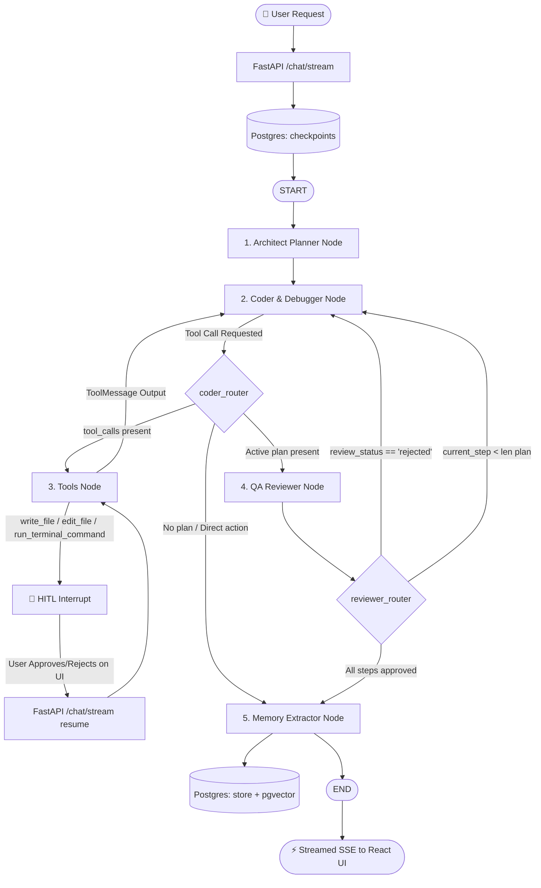

# 🌊 Saarthi AI — Complete Execution Flow & State Lifecycle

Dokument yeh explain karta hai ki jab user koi prompt bhejta hai, toh **FastAPI**, **LangGraph Multi-Agent StateGraph**, **HITL Interrupt**, **PostgreSQL**, aur **React Frontend** ke beech request kaise travel karti hai.

---

## 📌 Architecture Diagram



---

## 🧱 State Schema (`MyState`)

LangGraph ke har node me ek shared state object pass hota hai:

```python
class MyState(BaseModel):
    messages: Annotated[list[AnyMessage], add_messages]  # Chat history (Human, AI, Tool)
    response: str = ""                                  # Final answer text
    debug_retries: int = 0                              # Auto-debug counter
    plan: list[str] = []                                # 2-3 step actionable plan
    current_step: int = 0                               # Active plan step index
    review_status: str = "pending"                      # 'pending' | 'approved' | 'rejected'
    review_feedback: str = ""                           # Reviewer bug feedback
    completed_task: str = ""                            # Last verified step title
    memory_updated: bool = False                        # True if new fact was saved
    saved_count: int = 0                                # Kitne new facts save hue
```

---

## 🚀 Concrete Example Walkthrough

### 💬 User Query:
> *"Mera naam Harsh hai. Desktop par ek valid parentheses checker ka python code save kar do."*

Aaiye dekhte hain ki ye prompt har ek node se kaise guzarta hai aur har stage par `state` me kya save hota hai.

---

### 📍 Stage 0: Frontend ➡️ Backend Entry

1. User ne React UI par send button dabaya.
2. Frontend ne Server-Sent Events request bheji:
   `POST /chat/stream` with `thread_id="session_123"`.
3. `PostgresSaver` ne database se conversation history check ki (nayi chat hai toh empty).
4. Initial State create hui:

```json
{
  "messages": [
    { "type": "human", "content": "Mera naam Harsh hai. Desktop par ek valid parentheses checker ka python code save kar do." }
  ],
  "response": "",
  "plan": [],
  "current_step": 0,
  "review_status": "pending",
  "review_feedback": "",
  "memory_updated": false,
  "saved_count": 0
}
```

---

### 📍 Stage 1: `planner` Node (Architect Agent)

- **Kaam:** User query ko analyze karna.
- **Decision:** Query me `"desktop"` aur `"save"` keywords hain (Direct Save Intent). Planner ko pata chal gaya ki iske liye 3-step project plan ki zaroorat nahi hai, ye direct file creation task hai.
- **State Updates:**
  - `plan`: `[]` (Khali rakha gaya taaki unnecessary delay na ho)
  - `review_status`: `"approved"`

```json
{
  "plan": [],
  "current_step": 0,
  "review_status": "approved"
}
```

---

### 📍 Stage 2: `coder` Node (Software Engineer Agent)

- **Kaam:** LLM (`qwen2.5-coder:7b`) ko invoke karna system prompt aur user context ke sath.
- **Action:** Coder code generate karta hai aur samajh jata hai ki disk par file write karni hai.
- **Tool Trigger:** Coder text reply dene ke bajaye structured tool call generate karta hai:
  - `tool`: `"write_file"`
  - `args`:
    - `file_path`: `"C:/Users/Admin/Desktop/valid_parentheses.py"`
    - `content`: `def isValid(s: str) -> bool:\n    stack = []\n    mapping = {')': '(', '}': '{', ']': '['}\n    ...`
- **State Updates:**
  - `messages`: List me naya `AIMessage(tool_calls=[write_file])` add ho gaya.

---

### 📍 Stage 3: `coder_router` ➡️ `tools` Node

- `coder_router` ne check kiya:
  `tool_calls` present hain? ➡️ **YES**.
- Graph ab `tools` node par route hota hai.

---

### 📍 Stage 4: `tools` Node & 🛑 Human-In-The-Loop (HITL) Interrupt

1. Tool execution shuru hui: `write_file(...)`.
2. Kyunki `write_file` ek sensitive disk write operation hai, code me laga `interrupt({...})` trigger ho gaya:
   ```python
   decision = interrupt({
       "action": "write_file",
       "file_path": target_path,
       "preview": content[:3000],
       "char_count": len(content)
   })
   ```
3. **Graph Execution PAUSE ho gaya!**
4. Backend ne SSE event emit kiya:
   ```json
   data: {"type": "approval_required", "data": {"action": "write_file", "file_path": "C:/Users/Admin/Desktop/valid_parentheses.py", "char_count": 420}}
   ```
5. **React Frontend:** User ki screen par **Approval Card** pop-up hua jisme file path aur code preview dikha.
6. **User Action:** User ne UI par **"Approve"** click kiya.
7. Frontend ne resume call kiya:
   `POST /chat/stream` with `resume_approved=true`.
8. Graph wahi se resume hua, file disk par likh di gayi, aur tool ka output bana:
   `"Successfully wrote 420 characters to 'C:/Users/Admin/Desktop/valid_parentheses.py'."`
9. **State Updates:**
   - `messages`: `ToolMessage` add ho gaya jisme success output store hua.

---

### 📍 Stage 5: `tools` ➡️ Wapas `coder` Node

- LangGraph me edge hai: `builder.add_edge("tools", "coder")`.
- Coder ko ToolMessage mil chuka hai ki file save ho gayi.
- Coder ab natural language me user ke liye final polite reply generate karta hai:
  `"Maine Valid Parentheses checker ka code aapke Desktop par 'valid_parentheses.py' naam se save kar diya hai!"`
- **State Updates:**
  - `messages`: Final `AIMessage(content=...)` add hua.
  - `response`: Text store hua.

---

### 📍 Stage 6: `coder_router` ➡️ `memory_extractor` Node

- `coder_router` ne check kiya:
  - `tool_calls` hain? ❌ Nahi (turn complete ho chuka hai).
  - `state.plan` hai? ❌ Nahi (direct command tha, plan khali hai).
  - Router ne seedha **`memory_extractor`** ko route kiya (Reviewer bypass hua).

---

### 📍 Stage 7: `memory_extractor` Node (Auto Long-Term Memory)

- **Kaam:** Conversation scan karna ki kya koi personal user fact mila?
- **Analysis:**
  - User text: *"Mera naam Harsh hai..."*
  - Signal detected: `"mera naam"` ➡️ Match!
  - Extracted JSON: `[{"key": "name", "value": "Harsh"}]`
- **Database Saving:**
  1. `store.put(("user", "1"), "name", {"value": "Harsh"})` ➡️ PostgreSQL `store` table me direct key-value save.
  2. `save_semantic_memory("name", "Harsh")` ➡️ `qwen3-embedding:4b` se vector banke PostgreSQL `langchain_pg_embedding` table me save.
- **State Updates:**
  - `memory_updated`: `true`
  - `saved_count`: `1`

---

### 📍 Stage 8: Graph `END` & Checkpoint Commit

1. `memory_extractor` se graph `END` par pahocha.
2. `PostgresSaver` ne pure thread ki final state ko PostgreSQL `checkpoints` table me commit kar diya.
3. SSE stream client ko `{"type": "done"}` bhejkar close ho gayi.
4. User ko UI par typewriter animation se final reply aur live thought history dikh gayi!

---

## 📊 Summary: Kis Node Ne State Me Kya Badla?

| Node | Input State Key | Output State Modification | Agla Kadam |
| :--- | :--- | :--- | :--- |
| **`planner`** | `messages[HumanMessage]` | `plan = []`, `review_status = "approved"` | ➡️ `coder` |
| **`coder` (Turn 1)** | `messages`, `plan` | `messages += [AIMessage(tool_calls=[write_file])]` | ➡️ `tools` via `coder_router` |
| **`tools`** | `tool_calls` | `interrupt()` ➔ User Approved ➔ `messages += [ToolMessage(success)]` | ➡️ `coder` |
| **`coder` (Turn 2)** | `ToolMessage` | `messages += [AIMessage(final_text)]`, `response = text` | ➡️ `memory_extractor` via `coder_router` |
| **`memory_extractor`** | `messages` | `memory_updated = true`, `saved_count = 1` + Saved to Postgres Store/Vectors | ➡️ `END` |
