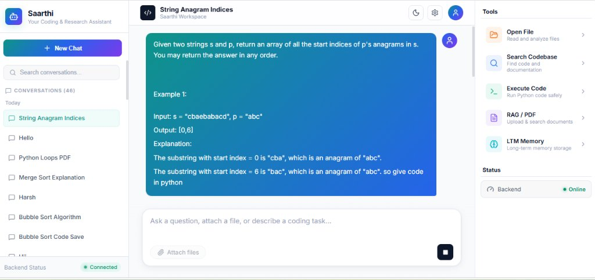
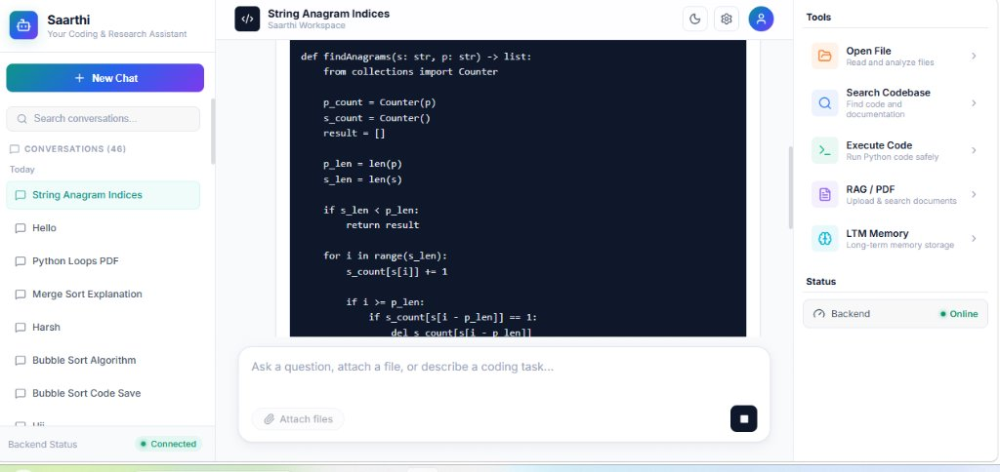
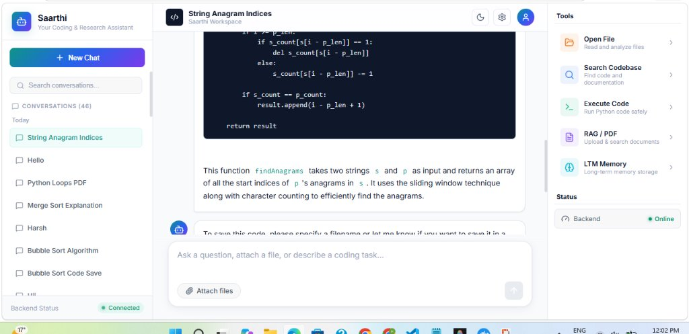
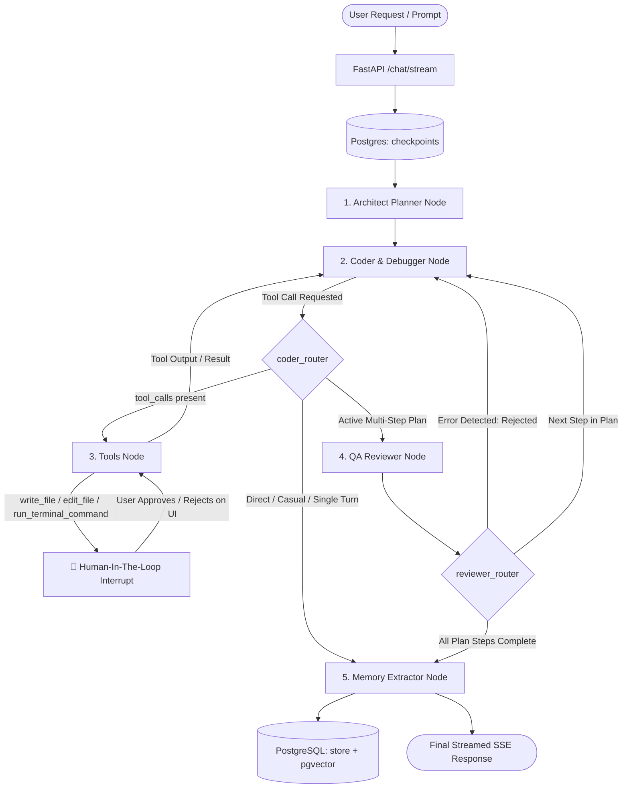

# 🚀 Saarthi — Autonomous AI Coding Agent & Assistant

<p align="center">
  
</p>

<p align="center">
  <b>An Autonomous, Multi-Agent AI Software Engineer with Human-In-The-Loop (HITL) Safety, Self-Debugging, and Dual-Layer Memory.</b>
</p>

<p align="center">
  
  
  
  
  
</p>

---

## 🌟 Highlights & Key Capabilities

- **🤖 Multi-Agent Orchestration**:
  - **Architect Planner**: Breaks down complex programming tasks into structured 2-4 step actionable blueprints.
  - **Coder & Debugger**: Implements solutions, manipulates files, executes commands, and writes clean code.
  - **QA Reviewer**: Verifies executions, inspects stdout/stderr, catches tracebacks, and approves or rejects steps.
- **🛡️ Human-In-The-Loop (HITL) Approvals**:
  - Sensitive operations (`write_file`, `edit_file`, `run_terminal_command`) pause graph execution and trigger frontend **Approval Cards**.
  - **Interactive Git-Style Diff Visualizer**: Real-time visual comparison showing additions (`+`) and deletions (`-`) before file changes are applied.
- **🚨 Autonomous Self-Debugging**:
  - Automatically captures non-zero terminal exit codes and Python syntax/runtime tracebacks, rewrites faulty logic, and re-executes without manual intervention.
  - **Auto-Package Recovery**: Detects missing Python modules (`ImportError` / `ModuleNotFoundError`) and initiates a `pip install` terminal approval card to resolve dependencies on the fly.
- **🧠 Hybrid Long-Term & Short-Term Memory**:
  - **Short-Term Session Memory**: Resilient checkpoints via LangGraph `PostgresSaver`.
  - **Key-Value Fact Memory**: Auto-extracts facts into `PostgresStore`.
  - **RAG Codebase & Memory Vectors**: Semantic similarity search using `pgvector` with Ollama embeddings.
- **⚡ Real-Time Thought Streaming**:
  - Server-Sent Events (SSE) stream the AI's internal reasoning, step transitions, tool executions, and diff previews directly to the React UI.

---

## 📸 Live Agent in Action (Real Demo)

> **Live Proof:** Saarthi solving LeetCode 438 (*Find All Anagrams in a String*), explaining the sliding window algorithm, and proactively asking to persist the file:

<p align="center">
  
  
  
</p>

1. **Intelligent Comprehension**: Automatically extracts problem constraints, examples, and edge cases.
2. **Clean Code Generation**: Produces optimal $O(N)$ sliding window logic with Python `collections.Counter`.
3. **Interactive Human Partnership**: Rather than blindly polluting the workspace, it presents the solution first and politely asks for confirmation and filename before executing disk operations.

---

## 🤖 Local Models Architecture

The entire system runs **100% locally** powered by Ollama:

| Model | Type | Library | Purpose & Responsibilities |
| :--- | :--- | :--- | :--- |
| **`qwen2.5-coder:7b`** | Chat LLM | `langchain-ollama` (`ChatOllama`) | • **Architect Planner**: Formulates 2-3 step execution roadmaps<br>• **Coder & Debugger**: Implements solutions & invokes tools<br>• **QA Reviewer**: Verifies executions & catches tracebacks<br>• **Memory Extractor**: Auto-detects user facts & habits<br>• **Title Generator**: Creates 3-5 word thread topic titles |
| **`qwen3-embedding:4b`** | Embeddings | `langchain-ollama` (`OllamaEmbeddings`) | • **Codebase Vectors**: Ingests code & PDFs into `collection: codebase`<br>• **Semantic Memory**: Embeds long-term user preferences into `collection: user_memories` |

---

## 🏗️ Architecture & Flow



### 🔄 State Schema (`MyState`)

Every node reads and mutates a central Typed State:

```python
class MyState(BaseModel):
    messages: Annotated[list[AnyMessage], add_messages]  # Merged chat history (Human, AI, Tool)
    response: str = ""                                  # Streamed response text
    debug_retries: int = 0                              # Autonomous self-debugging retry counter
    plan: list[str] = []                                # Discrete 2-3 step execution plan
    current_step: int = 0                               # Currently executing step index
    review_status: str = "pending"                      # 'pending' | 'approved' | 'rejected'
    review_feedback: str = ""                           # Reviewer feedback / traceback details
    completed_task: str = ""                            # Description of last completed step
    memory_updated: bool = False                        # Set True when new facts are saved
    saved_count: int = 0                                # Number of facts stored
```

---

## 🚀 Real-World Walkthrough: State Lifecycle

Consider this user prompt:
> **User Prompt:** *"Mera naam Harsh hai. Desktop par ek valid parentheses checker ka python code save kar do."*

Here is how each node processes the request and updates the internal state:

| Stage & Node | Action & Decisions | State Mutation (`MyState`) |
| :--- | :--- | :--- |
| **1. `START` ➔ `planner`** | Detects direct save intent (`"desktop"`, `"save"`). Skips unnecessary multi-step breakdown. | `plan: []`, `review_status: "approved"` |
| **2. `coder` (Turn 1)** | `qwen2.5-coder:7b` generates the algorithm and issues a structured tool call. | `messages += [AIMessage(tool_calls=[write_file])]` |
| **3. `tools` (HITL Interrupt)** | Sensitive operation pauses graph (`interrupt`). React UI shows **Approval Card**. User clicks **Approve**. File written to `~/Desktop/valid_parentheses.py`. | `messages += [ToolMessage("Successfully wrote 420 chars")]` |
| **4. `coder` (Turn 2)** | Receives `ToolMessage`. Formulates polite completion message to the user. | `messages += [AIMessage("Valid parentheses code save kar diya hai!")]`, `response = "..."` |
| **5. `memory_extractor`** | Scans dialogue, detects personal signal (*"Mera naam Harsh"*). Saves `name: "Harsh"` to `store` ($O(1)$) and `pgvector`. | `memory_updated: true`, `saved_count: 1` |
| **6. `END`** | Commits state snapshot into `checkpoints` table. Streams final tokens to React UI. | Checkpoint saved in PostgreSQL. |

---

---

## 📂 Project Structure

```
coading-agent/
├── assets/
│   └── ui_screenshot.png          # UI Screenshot preview
├── backend/
│   ├── main.py                    # FastAPI entrypoint
│   ├── config/
│   │   └── settings.py            # System prompts & runtime settings
│   ├── db/
│   │   └── connection.py          # PostgreSQL pools, checkpointer & store setup
│   ├── graph/
│   │   ├── builder.py             # LangGraph Multi-Agent StateGraph assembly
│   │   ├── nodes.py               # Planner, Coder, Reviewer & Memory nodes
│   │   ├── state.py               # MyState typed definition
│   │   └── tools.py               # Tool registry (read, write, edit diff, exec, terminal)
│   ├── rag/
│   │   ├── ingest.py              # Codebase chunking & pgvector ingestion
│   │   ├── retriever.py           # Similarity search retriever
│   │   └── vector_db.py           # Vector collection setup
│   └── routers/
│       ├── chat.py                # SSE streaming chat, title gen, approvals & file/PDF ingestion
│       ├── memory.py              # Long-term memory CRUD endpoints (store + pgvector)
│       └── rag_routes.py          # Vector similarity search test & collection stats
├── frontend/
│   ├── src/
│   │   ├── components/
│   │   │   ├── Chat/              # ChatHeader, MessageRow, ApprovalCard, ThoughtProcess
│   │   │   ├── RightPanel/        # Tools palette & active session inspectors
│   │   │   └── Sidebar/           # ThreadList, IngestPanel, MemoryPanel, BackendStatus
│   │   ├── services/api.js        # SSE consumer & REST API integration
│   │   ├── App.jsx                # Main layout orchestrator
│   │   └── index.css              # Glassmorphic design system
│   └── package.json
├── .gitignore                     # Production Git ignore patterns
└── README.md                      # Documentation
```

---

## 🚀 Quick Start Guide

### 1. Prerequisites
- **Python 3.10+**
- **Node.js 18+** & `npm`
- **Docker** (for PostgreSQL 16 + pgvector)
- **Ollama** installed locally

### 2. Start PostgreSQL Container
```bash
docker run --name ai-agent-db \
  -e POSTGRES_USER=postgres \
  -e POSTGRES_PASSWORD=MyNewPassword123 \
  -e POSTGRES_DB=postgres \
  -p 5433:5432 \
  -d pgvector/pgvector:pg16
```

### 3. Pull Ollama LLMs
```bash
ollama pull qwen2.5-coder:7b
ollama pull qwen3-embedding:4b
```

### 4. Setup Backend
```bash
cd backend

# Create virtual environment
python -m venv ../venv
..\venv\Scripts\activate      # On Windows
# source ../venv/bin/activate # On Linux/macOS

# Install dependencies
pip install fastapi uvicorn langgraph langchain-ollama langchain-postgres "psycopg[binary,pool]" python-dotenv langchain-text-splitters pgvector pypdf

# Run Backend
python main.py
```
*Backend runs at: `http://127.0.0.1:8000`*

### 5. Setup Frontend
```bash
cd frontend

# Install packages
npm install

# Start Vite Dev Server
npm run dev
```
*Frontend runs at: `http://localhost:5173` (or `5174`)*

---

## 🧠 Database & Memory Architecture

| Table | Technology | Purpose |
| :--- | :--- | :--- |
| **`checkpoints`** | `PostgresSaver` | Stateful chat history, thread state, and interrupt resumption |
| **`store`** | `PostgresStore` | Long-term key-value facts extracted autonomously about user preferences |
| **`langchain_pg_embedding`** | `PGVector` | Codebase vectors & semantic user memory embeddings |
| **`langchain_pg_collection`** | `PGVector` | Groups collections (`codebase`, `user_memories`) |

---

## 🛠️ Available Agent Tools

| Tool | Action | Safety Level |
| :--- | :--- | :--- |
| `read_file` | Inspects workspace code files | Auto-Approved |
| `list_directory` | Navigates directories and folder trees | Auto-Approved |
| `search_codebase` | Semantic vector search across all files and ingested PDFs | Auto-Approved |
| `write_file` | Creates or overwrites complete files | ⚠️ **HITL Approval Required** |
| `edit_file` | Applies unified diffs / selective replacements | ⚠️ **HITL Approval Required** |
| `run_terminal_command`| Executes shell commands safely | ⚠️ **HITL Approval Required** |
| `execute_python_code` | Runs Python scripts in memory with self-debugging | Sandboxed Execution |
| `get_memory` | Retrieves specific user preference or fact by key | Auto-Approved |
| `list_memories` | Lists all stored persistent user preferences & facts | Auto-Approved |
| `save_memory` | Manages and updates persistent user preferences | Auto-Approved |

---

## 📄 License
MIT License. Built for advanced autonomous coding and research.
